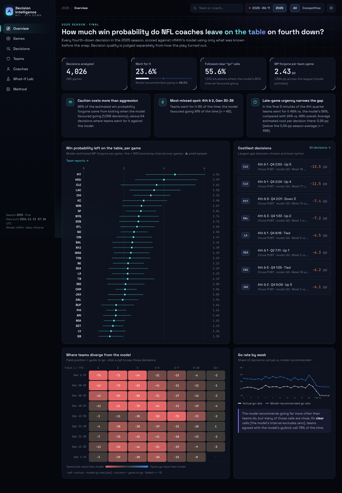

# NFL Decision Intelligence

How much win probability do NFL teams leave on the table on fourth down, and which teams and coaches decide best?

This project scores **every fourth-down decision** in the 2025 season and the live 2026 season against an established analytical model ([nfl4th](https://github.com/nflverse/nfl4th)). It uses only information available before the snap, and it keeps *decision quality* separate from *what happened*.



## What's here

| Layer | Location | What it does |
|---|---|---|
| Ingestion | `src/nfldi/nfl/sources.py` | Downloads nflverse play-by-play and nfl4th's precomputed values; records SHA-256 + timestamp of every snapshot in `data/snapshots.json` |
| Decision detection | `src/nfldi/nfl/decisions.py` | Classifies each 4th-down snap by **intent** (go / punt / FG), groups re-snaps into one decision, logs a reason for every exclusion |
| Metrics | `src/nfldi/nfl/metrics.py` | Best option, WP cost, confidence tier, error type. **All units and sign conventions are defined in this one file.** |
| Aggregation | `src/nfldi/nfl/aggregate.py` | Team/coach summaries with game-level bootstrap intervals; situation grids |
| Export | `src/nfldi/nfl/export.py` | Static JSON for the web app |
| Web app | `web/` | No-build vanilla JS single-page app (address bar shows simple names like `team-PIT`, `decision-2025-18-CLE-CIN-3455`): overview, game explorer, decision detail, decision search, team & coach reports, what-if lab, methodology |
| Validation | `scripts/validate.py` → `docs/VALIDATION_*.md` | Identity checks, comparison with nfl4th's own go/kick coding, stratified manual-review sample |
| Tests | `tests/` | 26 tests on hand-built plays: classification, sequencing, metric arithmetic, bootstrap |

Sport-specific code lives under `nfldi/nfl/` so an NBA module can bring its own data model and assumptions later.

## Quick start

```bash
uv venv && uv pip install -e ".[dev]"
nfldi build --season 2025 --season 2026:live   # downloads data on first run
python -m http.server 8000 -d web              # open http://localhost:8000
```

```bash
python scripts/build_artifact.py        # single-file bundle (inline CSS/JS) in dist/artifact/
pytest                                  # calculation tests
python scripts/validate.py 2025         # regenerate the validation report
nfldi refresh --season 2026             # new weekly snapshot for the live season
```

## Key definitions

* **WP cost** = `100 × (best_wp − chosen_wp)`, in **percentage points**, never negative.
* **Go − kick** (`go_boost`, from nfl4th) = `100 × (go_wp − max(punt_wp, fg_wp))`, signed, in pp. The pipeline reproduces nfl4th's value exactly.
* **Tier**: *clear* when nfl4th's 80% bootstrap interval for go − kick excludes zero, otherwise *toss-up*.
* **Decision**: consecutive 4th-down snaps by one offense on one drive count as one decision, valued at the last snap whose intent is known. Fakes count as *go*.
* **Team/coach intervals**: 90% bootstrap over games (sampling variability only).

## Findings (2025 regular season + playoffs, model-based)

These come from the current snapshot and depend on nfl4th's assumptions. They are not causal claims.

* 4,026 eligible decisions. Teams went for it **23.6%** of the time; the model favoured going in **48.5%**.
* On the 1,510 **clear-go** situations, teams went for it only **55.6%** of the time.
* **96%** of the estimated WP forgone came from kicking when the model favoured going, not from over-aggression (1,058 vs 54 decisions).
* The model-estimated cost averages **2.4 pp per team-game**. Team intervals overlap heavily in the middle of the table; only the extremes separate.
* Largest single cost: CLE punting on 4th & 1 from its own 18, up 5 with 2:50 left in week 18 (−13.5 pp).

## Limitations (also on the app's Methodology page)

* nfl4th adjusts for the betting spread/total, but not the specific kicker, injuries, personnel or weather beyond roof type.
* The bootstrap covers only nfl4th's own conversion and first-down WP models; true uncertainty is wider.
* The model was fit on seasons that include these, so this is an in-sample evaluation.
* Decisions are attributed to the nflverse-listed head coach.
* nfl4th's precomputed file has no per-branch probabilities (conversion %, FG make %). Adding those needs a pinned R export, which is the next step for the what-if lab.

## Data & credits

Play-by-play: [nflverse](https://github.com/nflverse/nflverse-data). Fourth-down model: [nfl4th](https://github.com/nflverse/nfl4th) by Ben Baldwin (MIT). Not affiliated with the NFL or any team. Check nflverse's terms before redistributing raw data.
